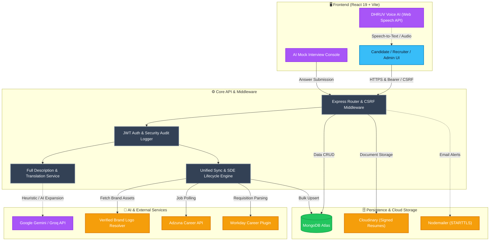

# SkillBridge 🚀

**Bridging talent and opportunity in one intelligent, full-stack career platform.**

[](https://github.com/Chinmay0608/job-portal-system/actions/workflows/ci.yml)
[](https://job-portal-system-alpha.vercel.app)
[](LICENSE)
[](backend/tests/)

SkillBridge is a modern MERN-stack job portal connecting **Candidates**, **Recruiters**, and **Administrators**. It integrates AI-powered voice career coaching, automated real-time mock interviews, multi-source job aggregation (Adzuna, Workday, career boards), verified company branding, and enterprise-grade security middleware.

---

## 🌟 Live Application

- **Production App**: [https://job-portal-system-alpha.vercel.app](https://job-portal-system-alpha.vercel.app)
- **Backend API**: Hosted on Oracle Cloud Infrastructure (OCI) with MongoDB Atlas, Redis caching, and automated cron syncs.

---

## 🚀 Key Highlights & Capabilities

- 🤖 **DHRUV Voice Coach**: Interactive career mentor supporting Speech-to-Text (STT) and Text-to-Speech (TTS) voice readback for job matching and resume coaching.
- 🎙️ **AI Mock Interview Assistant**: Domain-tailored technical & behavioral interviews with real-time speech responses, scoring rubrics, and feedback powered by Gemini / Groq with heuristic fail-safes.
- 🔄 **Unified Job Aggregator Engine**: Automated aggregator syncing live openings across Adzuna, Workday, and employer portals with intelligent deduplication and SDE lifecycle management (Active / Stale / Dormant).
- 📝 **Structured Description & Translation Engine**: Auto-repairs scraped postings into 9 standardized sections (`Role Summary`, `Key Responsibilities`, `Required Qualifications`, etc.) and translates foreign-language listings into clear English.
- 🎨 **Verified Brand Logos**: High-fidelity company branding system resolving verified logos from Clearbit, Brandfetch, SVGL, and custom vector SVGs with strict fallback guards.
- 🔒 **Enterprise Security Architecture**: Custom CSRF protection middleware, security audit logging, time-expiring signed Cloudinary resume URLs, and resilient STARTTLS email dispatching.
- 🧪 **Comprehensive CI Quality Gate**: Automated dual-stage CI pipeline running 20 test suites (108 unit tests) and frontend linting/compilation before deployment.

---

## 🏗 System Architecture



---

## 🧰 Tech Stack

| Domain | Technologies |
| --- | --- |
| **Frontend** | React 19, Vite, Tailwind CSS, Lucide React, React Router v7, Axios, Web Speech API |
| **Backend** | Node.js (v20+), Express.js (v5), Mongoose, Cheerio, JWT Authentication |
| **Database & Caching** | MongoDB Atlas, Redis Caching, In-Memory Fallbacks |
| **AI & Natural Language** | Google GenAI (Gemini), Groq API, Rule-Based Natural Language Parsers |
| **Storage & Media** | Cloudinary (Signed Expiring Resume URLs) |
| **Email & Alerts** | Nodemailer with RFC-compliant STARTTLS fallback |
| **Job Aggregation** | Adzuna API, Workday Career Scraper, SDE Priority Crawl Scheduler |
| **Branding & Logos** | Clearbit Logo API, Brandfetch, SVGL, Vector SVG Brand Assets |
| **Testing & CI/CD** | Jest, Supertest, ESLint, GitHub Actions (Dual CI Quality Gates), Vercel |

---

## 🎯 Role-Based Modules

### 1. 🎓 Candidate Portal
- **Smart Job Search & Filtering**: Filter by title, tech stack, location, salary range, and work mode (Remote / Hybrid / On-site).
- **One-Click Application Flow**: Apply seamlessly with uploaded resumes, personal details, and instant status tracking.
- **Application History**: Track requisition states (`Pending`, `Reviewed`, `Shortlisted`, `Rejected`) with real-time updates.
- **Saved Opportunities**: Bookmark roles for later review with persistent candidate dashboards.
- **DHRUV Voice Coach**: Ask career questions verbally and listen to tailored recommendations in real time.
- **AI Mock Interview Room**: Practice technical questions with speech input, automated evaluation, and actionable feedback.

### 2. 💼 Recruiter Portal
- **Job Requisition Management**: Draft, publish, edit, feature, and close job postings.
- **Applicant Tracking Pipeline**: View candidates per role, inspect authenticated resume previews, and update candidate stages.
- **Direct Candidate Notifications**: Automatic branded email notifications sent on application status updates.

### 3. 🛡️ Admin Control Center
- **System Metrics**: Real-time overview of total platform users, active listings, job sync health, and applications.
- **Manual & Scheduled Sync Controls**: On-demand triggers for job crawlers and synchronization diagnostics.
- **User Feedback & Moderation**: Manage candidate inquiries, hide invalid job postings, and review security audit logs.

---

## 🧪 Testing & Quality Gates

The project enforces strict automated checks on every pull request and push to `main`:

```bash
# Backend Test Suite (20 Test Suites | 108 Tests)
cd backend
npm test -- --runInBand --forceExit

# Frontend Lint & Production Compilation
cd ../frontend
npm run lint
npm run build
```

### Coverage Highlights:
- **Security & CSRF**: Verifies header presence, CSRF token generation, origin validation, and state-changing verb protection.
- **Full Description Service**: Tests JSON-LD extraction, HTML sanitization, section categorization, bullet list parsing, and employer posting validation.
- **Sync & Lifecycle Engine**: Validates deduplication, crawl priority scheduling (Active / Stale / Dormant), and Workday plugin integration.
- **AI Interview Assistant**: Tests fallback heuristics when AI APIs are unreachable, scoring accuracy, and domain question generation.

---

## ⚙️ Quick Start & Local Setup

### 1. Clone the Repository

```bash
git clone https://github.com/Chinmay0608/job-portal-system.git
cd job-portal-system
```

### 2. Backend Setup

```bash
cd backend
npm install
```

Create a `.env` file in the `backend/` directory:

```env
PORT=5000
NODE_ENV=development
MONGODB_URI=mongodb+srv://<username>:<password>@cluster.mongodb.net/job-portal
JWT_SECRET=your_jwt_secret_key
SYNC_SECRET_KEY=your_sync_secret_key

# Cloudinary (Resume Storage)
CLOUDINARY_CLOUD_NAME=your_cloud_name
CLOUDINARY_API_KEY=your_cloudinary_key
CLOUDINARY_API_SECRET=your_cloudinary_secret

# Email Dispatch
EMAIL_USER=SkillBridge684@gmail.com
EMAIL_PASS=your_gmail_app_password

# Job APIs (Optional for external crawl)
ADZUNA_APP_ID=your_adzuna_id
ADZUNA_APP_KEY=your_adzuna_key

# AI Services (Optional for AI interview & translation)
GEMINI_API_KEY=your_gemini_key
GROQ_API_KEY=your_groq_key

# Allowed Origins
FRONTEND_URL=http://localhost:5173
ALLOWED_ORIGINS=http://localhost:5173
```

Start the backend:

```bash
npm run dev
```

### 3. Frontend Setup

```bash
cd ../frontend
npm install
```

Create a `.env` file in the `frontend/` directory:

```env
VITE_API_BASE_URL=http://localhost:5000
VITE_FIREBASE_API_KEY=your_firebase_api_key
```

Start the Vite development server:

```bash
npm run dev
```

Visit `http://localhost:5173` to explore SkillBridge locally.

---

## 📄 License

This project is open-source and licensed under the [MIT License](LICENSE).

You are free to use, copy, modify, merge, publish, distribute, and sublicense this software for personal or commercial projects, provided the original copyright notice is preserved.

---

## 🤝 Contact & Contributions

Contributions, bug reports, and suggestions are welcome!

- **Lead Developer**: [Chinmay Maheshwari](https://github.com/Chinmay0608)
- **Official Support**: [SkillBridge684@gmail.com](mailto:SkillBridge684@gmail.com)
- **GitHub Repository**: [Chinmay0608/job-portal-system](https://github.com/Chinmay0608/job-portal-system)
